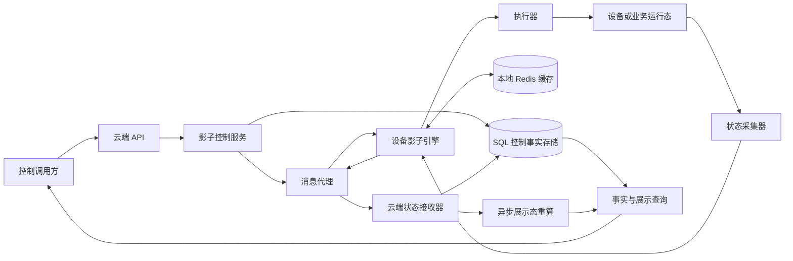
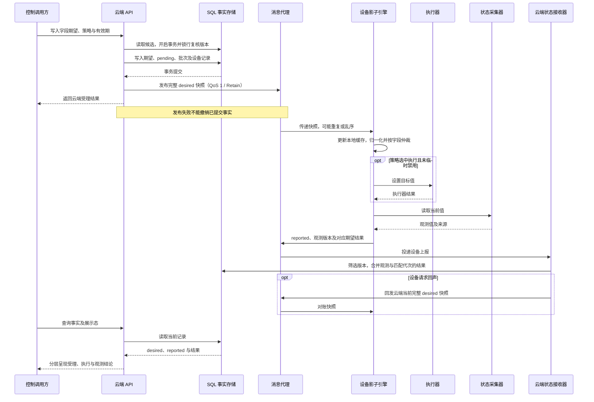
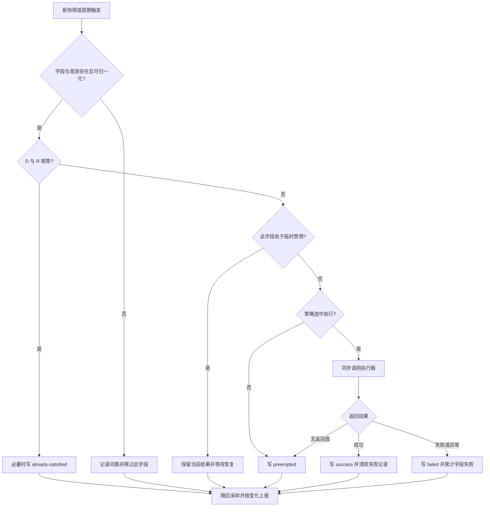

# 从消息送达到状态收敛：一套字段级 IoT 设备影子控制方案


把 `speed_limit` 写入数据库，消息代理返回表示接受的 PUBACK，设备执行器返回成功，采集器终于读到目标值——这四件事可能相隔很久，也可能只完成其中一部分。

**云端受理、消息投递、设备执行、物理状态收敛是四个不同边界。** 设备影子的价值，是把这些边界之间暂时断开的链路组织成可查询、可恢复的状态协调过程。它不能让一次传输确认自动升级为一次物理动作的成功证明。

本文以一套参考实现为主线，讨论字段级期望态、上报态、策略和命令结果怎样共同工作。文中的“当前参考实现”来自静态实现核验，不代表经过生产故障注入验证；“官方语义”用于行业对照；“增强建议”则是尚需独立建设的能力。

这套方案适合“最终应当是什么”的可重复设置，例如 `indicator`、`speed_limit` 和 `operation_mode`。需要计数、不可合并或具有不可逆副作用的动作，应采用独立命令日志与持久化执行幂等设计，不能直接把重放目标状态当作安全的动作重试。

## 1. 先把四个边界放进架构

| 边界 | 可以证明什么 | 仍需什么证据 |
| --- | --- | --- |
| 云端受理 | 某代期望及控制记录已经持久化 | 发布是否成功、设备是否收到 |
| 消息投递 | 特定传输环节接管了消息 | 设备应用是否处理、执行器是否调用 |
| 设备执行 | 执行器返回了业务结果 | 实际状态是否改变、是否保持稳定 |
| 物理状态收敛 | 足够新鲜且可信的观测达到目标 | 按业务要求继续检查持续时间或安全约束 |

这里的“消息投递”也必须注明位置：云端发布者收到表示接受的 PUBACK（reason code < 0x80，缺省为成功），仅证明代理在该传输边界接受/处理了 PUBLISH；`0x10 No matching subscribers` 仍是接受，但没有匹配的订阅者。原因码为 0x80 及以上则表示失败，不能据此认为消息已被接受。即使 PUBACK 表示接受，也不能证明最终订阅者已经完成处理或业务执行成功。MQTT 5.0 第 3.4.2.1 节定义了这些原因码，第 4.3.2 节允许接收方在完成应用消息后续交付之前发送 PUBACK。[OASIS MQTT 5.0 标准](https://docs.oasis-open.org/mqtt/mqtt/v5.0/mqtt-v5.0.html)



SQL 保存原始控制事实，本地 Redis 保存设备已知的期望、观测与结果。消息代理传输快照和上报；设备引擎负责仲裁，执行器负责调用具体能力，采集器负责读取当前状态。展示重算消费事实，生成适合 UI 或运营阅读的视图。

采集器的来源决定证据等级：来自独立遥测的 `indicator`，与来自本地管理器或缓存的 `operation_mode`，即使都叫 reported，也不能提供相同强度的物理证据。本文中“观测”包括业务当前态；只有来源足够可靠时，才进一步称为物理收敛。

## 2. 字段模型：目标、观测和执行结果各有自己的位置

下面是经过抽象的字段模型，不是可直接复制的生产 Schema。协议实际以 Protobuf 传输，字段值以字符串承载，具体类型由两端元数据解释。

| 概念字段 | 含义 | 必须保留的约束 |
| --- | --- | --- |
| `key` | 如 `speed_limit` 的能力字段 | 是仲裁、版本及失败隔离的粒度 |
| `desired.value` | 云端希望达到的值 | 不是设备当前值 |
| `desired.version` | 此次字段期望的版本 | 当前以纳秒墙上时钟或调用者指定时间戳表示 |
| `reported.value` | 设备最近读取的当前值 | 可以来自遥测、管理器或缓存 |
| `reported.version` | 此次观测或本地控制更新的版本 | 与 desired 版本分别维护；不是其简单回执副本 |
| `policy` | 版本优先、云端优先或带有效期策略 | 按字段指定，执行规则见下一节 |
| `ttl` | 有效期秒数 | 当前仅策略 2 使用；截止时间由 desired 版本时间加 TTL 得到 |
| `result.desired_version` | 结果对应哪一代期望 | 防止旧结果覆盖新目标的结果 |
| `result.status` | 五种命令结果之一 | 结果存在性与枚举默认值必须区分 |
| `result.reason_category` | 便于公开表达的错误类别 | 是本文抽象，不是新增的线协议枚举 |

原因类别可以用“输入不可解释”“执行器拒绝”“执行调用异常”“策略未选中”表达。当前协议传递结果和原因字符串，并没有完整的标准错误分类体系；类型归一化失败甚至只记录并跳过，不自动产生 `failed`。生产设计需要另行规定稳定类别及可重试性。

消息还有以秒为单位的时间戳及是否请求回声的标记。消息时间戳不是逐字段仲裁版本。当前协议也没有独立的文档并发版本、逻辑目标代次或 `command_id`，不能把字段时间戳视为已经同时解决了这三个问题。

空字符串不是通用删除指令：当前持久化路径会把部分空值当作“不改写该列”。设备端却按完整 desired 快照处理缺失字段，因此“字段缺失”和“字段值为空”有不同后果。协议设计应把这两种语义写清楚。

## 3. 一次控制怎样完成闭环



图中 API 返回的是云端处理结论。即使返回成功，仍不能据此承诺 MQTT 发布成功；当前发布错误只被记录，并不向批量调用方传播。反过来，提交后缓存失效回调如果失败，也可能让调用返回错误而数据库已经提交。调用方需要读取事实确认当前代次，不能把任何异常都理解为数据库回滚。

执行结果和采样可以在不同轮次发生。当前引擎先仲裁再采样，执行成功不会直接把 desired 值复制成 reported。这样保留了两种事实的区分，也意味着执行器已经成功而 reported 暂时未变化，是合法的中间状态。

## 4. 三种策略，以及容易被名称掩盖的差异

记归一化后的期望和当前值为 `D`、`R`，对应版本为 `dv`、`rv`。对有效期策略，`deadline = dv / 1e9 + ttl`。下表以字段已注册、已有观测、可以归一化且未被临时禁用为前提。

| 策略 | `D = R` | `D ≠ R` 时设备何时执行 | 典型用途 |
| --- | --- | --- | --- |
| 0：最新版本优先 | 不调用执行器 | 严格要求 `dv > rv` | 允许较新的本地控制覆盖旧云端目标 |
| 1：云端期望优先 | 不调用执行器 | 不比较版本或 TTL，持续尝试目标 | 云端作为该字段的持续权威 |
| 2：带有效期的最新版本优先 | 不调用执行器 | `now <= deadline`，不要求 `dv > rv` | 在期限内坚持云端目标，过期后停止追赶 |

策略 2 的名称需要谨慎理解：当前设备执行语义实际上是“期限内云端优先”。假设本地观测版本已经比云端目标新，只要值不同且尚未过期，设备仍然会执行云端目标。不能从“最新版本”四个字推导出它会立即让位于更新的本地版本。

相等判断先于策略和有效期判断。值已经相等时，即使期限已过，也可以把此前未产生结果、`pending` 或 `failed` 更新为 `already-satisfied`；已有 `success`、`preempted` 或 `already-satisfied` 会保留。此分支还位于临时禁用检查之前。

设备执行判断与云端 `Expected` 展示判断也不完全对称。当前 `Expected` 大致表达“该目标已满足或不再需要坚持”，不只表达物理值相等：

| 策略 | 两值相等时 | 两值不等时 `Expected = true` 的额外条件 |
| --- | --- | --- |
| 0 | true | `rv > dv` |
| 1 | true | 无，保持 false |
| 2 | true | 云端当前时间严格超过 deadline，或者 `rv > dv` |

因此策略 2 存在明确窗口：`rv > dv` 且尚未过期时，云端可能显示 `Expected = true`，设备仍会调用执行器。两端还分别使用自己的时间计算有效期。`Expected` 不宜直接命名为“执行成功”或“物理收敛”。策略 0、2 在该展示条件成立但值仍不同时，会把展示负载中的 desired 值置为未知；这只修改展示对象，不改写原始 SQL 事实。

## 5. 云端：事务保护事实，版本约束更新

当前 HTTP 入口先对设备集合及字段集合去重，逐设备检查相应权限，并记录操作者与来源。通用批量函数并不自动重复这一入口去重行为。输入校验覆盖已知字段、策略及 TTL：负 TTL 被拒绝，策略 2 要求正 TTL；这一路径没有完成字段值类型转换、时间戳非负检查或 TTL 上限约束。

批量处理先在事务外读取旧状态，形成候选集合；事务内按字段创建控制批次，再逐设备锁行读取，复核 `old.desired.version >= new.desired.version` 时跳过更新。这个版本复核对云端优先策略也成立，所以“设备执行时忽略版本”不等于“云端写入时也忽略版本”。只有新期望实际写入时，结果才重置为 `pending`。

候选筛选还有一处差异：新旧均为云端优先时，请求值与已有 reported 值比较；其他情况主要比较 desired 版本。锁行复核后可能跳过影子写入，但已经构造的控制记录仍会保留。因而批次中的设备数、控制记录数以及后续发布目标数，都不能直接作为实际更新成功数。

同一事务保存期望、字段级控制批次及逐设备前值记录。对并发插入冲突和死锁，当前事务包装最多总共尝试三次。提交之后才查询并发布设备可读取的完整字段集合，避免把尚未提交的目标发给设备。然而 SQL 提交与 MQTT 发布仍是两个动作，当前链路没有事务性 outbox，无法原子保证二者同时成功。

这里存在几种不同的“幂等”：入口集合去重减少重复工作；行锁后版本比较避免同代或旧代 desired 覆盖；设备同版本快照保留已有结果；上报按观测版本筛选。这些机制都不能保证执行器只调用一次。采样尚未变化时，周期仲裁仍可能再次调用执行器，故 setter 本身应能安全重复执行。

上报合并允许相同 reported 版本更新命令结果，但要求结果携带所对应的 desired 版本、状态与原因信息，且该版本匹配云端当前期望。较旧代次的执行结果不能据此改写新代次结果。不过当前上报版本筛选在事务前进行，没有在写入事务内再次锁行复核，仍存在并发窗口；相同 reported 版本且结果枚举相同会跳过整个字段，也可能忽略原因或关联代次的变化。

## 6. 设备侧：适配器、双触发仲裁与字段隔离

字段注册把“如何读取”“如何设置”和“按什么类型比较”聚合在一起。增加一个能力时，首先明确 reported 的来源和可信程度，再提供对应读取器与执行器。协议使用字符串不意味着应当使用字符串字面值判断所有字段相等：数值、布尔值及文本必须按注册类型归一化。

当前实现会进行类型归一化再比较，但不是任意结构的深比较：文本保留文本语义，浮点采用精确相等，不同 JSON 序列化形式也可能造成持续不等；云端与设备对空白的处理还有差异。这些细节决定了一个看似无害的编码差别是否会触发反复设置。

以下仅为说明算法的中性伪代码，以字段已注册且已有观测为前提；`normalize` 按注册类型转换，不增加浮点容差或结构深比较能力。转换异常只跳过该字段的仲裁，之后外层工作循环仍会采样。

```text
for each field in desired_fields:
    registered_type = registry[field.key].type
    try:
        D = normalize(field.desired.value, registered_type)
        R = normalize(reported[field.key].value, registered_type)
    catch ConversionError:
        record_conversion_problem(field.key)
        continue
    if D == R:
        handle_already_satisfied(field)
    else:
        arbitrate_policy(field, D, R)
```



MQTT 回调向有界内存队列投入消息，工作循环每轮最多取一条。收到快照会立即触发仲裁，没有新消息时也会周期仲裁。循环随后采样注册字段，值变化时生成设备侧观测版本并更新本地内存与 Redis。读取为无值时跳过，不能把它当成已观察到的空状态。

以下都是**当前参考实现参数，不是行业标准或实时性承诺**：队列容量为 1000 条，入队最多等待 0.1 秒后可丢弃满队列消息；无新消息时约每 10 秒仲裁。执行器是同步调用，慢执行会延迟其他字段及采样，字段隔离不等于线程或时间隔离。

失败降级按字段记录：相邻两次失败间隔不超过 60 秒时累计，间隔更长从一重新计算；连续达到 2 次后，禁用该字段 300 秒。这不是通用滑动时间窗口计数器。禁用到期后可再尝试；严格高于上次失败版本的新 desired 或一次成功执行可清除失败记录。较旧但“不相等”的版本并不能解除禁用，值相等也不会自动清掉失败记录。

这个机制能限制单字段反复失败，但类型归一化异常、缺少观测或临时禁用只会跳过，不一定输出新的失败结果。查询端不能把“结果长时间不变”自动解释为设备正在执行。

## 7. 命令结果是执行契约，不是物理完成状态机

| 结果 | 当前参考实现中的含义 | 不应据此断言 |
| --- | --- | --- |
| `pending` | 云端实际写入新期望后等待结果；云端优先还可能在后续不一致时以上报出口转换重新呈现此状态 | 设备已经收到或开始执行 |
| `already-satisfied` | 仲裁时值已相等，且此前结果适合更新 | 本次调用执行器完成了动作 |
| `success` | 执行器返回了可识别的成功结果 | 物理状态已经收敛 |
| `failed` | 执行器返回失败或调用异常转换为失败 | 所有失败原因都已更新，或超时已证明未执行 |
| `preempted` | 策略未选中执行，或者执行器没有返回结果 | 一定发生了另一控制源抢占 |

`success` 只是执行器返回成功。有的适配器会把底层受理、无需动作甚至待完成映射成成功；这些仍需后续采样验证。引擎保持 desired、reported 与命令结果分离，正是为了让这种中间状态可见。

`preempted` 同时包含版本让位、期限已过和执行器无返回值等情况，不能一律翻译成“被其他人控制”。连续 `failed` 时原因变化也不一定立即持久化或上报。当前协议没有独立的 `executing`、`expired`、`rejected`、`unknown` 或重试类别，这五种结果因此不足以表达所有执行过程。

云端优先还有一个出口特例：若本地版本更高、值再次不同，而原结果是 `success` 或 `already-satisfied`，设备上报会临时呈现 `pending`，不改写本地保存的原结果。它表达目标仍需坚持，说明这些结果并不是一次只向前推进、永不回退的完整业务状态机。

## 8. 离线与重启：Retain、回声和本地恢复分别补哪一段

当前云到设备使用 QoS 1 和 Retain，设备到云使用 QoS 1 且实际发布器默认不 Retain，云端观察消息也使用 QoS 1 和 Retain。保留最后一条快照有助于订阅恢复，但 Retain 不保存完整命令历史，也不提供字段合并、并发版本控制或业务执行确认。MQTT 会话状态和 retained message 还是不同机制；恢复会话不等于恢复应用状态。[OASIS MQTT 5.0，第 3.3.1.3、4.1、4.3 节](https://docs.oasis-open.org/mqtt/mqtt/v5.0/mqtt-v5.0.html)

设备每次上报包含缓存的完整观测集合，必要时携带关联期望的命令结果。首轮会强制发布，但不请求回声；随后存在**距离上一次实际发布约 120 秒的空闲回声；持续变更会重置计时**。设备在该次上报中请求云端返回当前快照，云端收到后回发，从而形成双向对账。这不是固定每两分钟一次的独立任务，也不能保证持续高频变化时两分钟内一定完成完整对账。

本地恢复从 Redis 加载 desired 与 reported 缓存，单项损坏会跳过，顶层读取失败则重试。内存先更新、Redis 写入异常只记录，所以恢复依赖此前写入成功以及 Redis 自身的持久性。队列、失败计数、临时禁用、发布计时和仲裁计时不跨设备进程重启恢复。启动后的就绪等待、缓存加载和首次采样构成恢复窗口，在此期间不能承诺已有全部控制上下文。

还有一个重要限制：设备把消息当完整快照，缺失的字段从本地缓存删除；已有字段只要传入版本与缓存不相等，就会替换，没有严格的“只接受更大版本”。旧整包到达时可能回退字段，或删除后来新增的字段。QoS 1、Retain 和回声都不能自动消除这个窗口。

行业上更稳健的重连算法，是先订阅更新，再读取完整快照，使用单调版本合并并丢弃旧通知。Azure 官方明确规定了这个顺序；AWS 设备指南也强调连接与重连时读取影子和处理更新。当前参考实现的回声路径不等价于已实现这套算法。[Azure device reconnection flow](https://learn.microsoft.com/en-us/azure/iot-hub/iot-hub-devguide-device-twins#device-reconnection-flow)、[AWS Using shadows in devices](https://docs.aws.amazon.com/iot/latest/developerguide/device-shadow-comms-device.html)

## 9. 原始控制事实与展示态分别回答什么问题

原始事实回答：“云端哪一代目标是什么，设备报告了什么，执行器对哪一代给过什么结果？”面向 UI 或运营的展示态回答：“哪些目标仍需要关注，当前页面该怎样解释这些事实？”两者不能互相替代。

当前链路在原始影子发生变更后投递异步重算，并尝试发布观察负载。展示发布使用 Redis 保存的快照比较来抑制相同内容，只有发布成功才更新比较基线。这减少重复通知，但不等于执行器幂等；异步展示也可能晚于原始事实。

前文的 `Expected` 和把失效目标显示为未知，属于展示解释。它们不能反过来充当设备控制前置条件，不能覆盖 SQL 中保存的原始 desired，更不能用于统计物理执行成功率。

异步链路必须有自己的可靠性契约。当前入队失败只记录日志；不能据此宣称有可靠派生队列。**增强建议**是保存待重算任务、进行有界重试，并将持续失败任务放入死信，由告警、回放和周期修复处理。死信提供“失败仍可见、可恢复”的落点，不证明任务已经执行，更不能自动弥补上游没有持久化的入队丢失。

同理，用 payload 哈希辅助发布去重或幂等时，不能假定 Protobuf 消息天然提供确定性序列化保证。应显式启用 deterministic serialization，或先规范化业务字段再计算哈希；确定性序列化也不是跨语言、跨构建或跨版本的通用规范化表示。[Protobuf：Proto Serialization Is Not Canonical](https://protobuf.dev/programming-guides/serialization-not-canonical/)

## 10. 与官方影子、孪生和 MQTT 语义对照

这些系统提供的是可借鉴的契约，不应把它们的能力自动算作本参考实现已有的能力。

| 官方体系 | 核心语义 | 对本方案的启示 |
| --- | --- | --- |
| AWS IoT Device Shadow | desired 描述应用目标，reported 描述设备上报，delta 表示差异；文档 version 支持条件更新 | 字段目标与观测应分开；本文的时间戳字段版本不等于 AWS 文档版本 |
| Azure IoT Hub device twins | desired 与 reported 各有递增版本，ETag 支持条件更新；重连需要快照与通知协调 | 并发版本、通知排序及设备恢复是明确的协议契约 |
| Eclipse Ditto | twin channel 操作持久化孪生，live channel 让设备参与响应 | 目标状态协调与即时设备命令可以采用不同通道 |
| MQTT 5.0 | QoS 约束传输交付，Retain 保存主题最后值；消息过期与相关性属性辅助应用协议 | 传输可靠性与控制结果需要分别设计 |

AWS 的 shadow accepted 表示影子更新被接受，仍需设备处理目标并上报；`clientToken` 解决请求响应关联，不是物理完成凭证。[AWS Device Shadow documents](https://docs.aws.amazon.com/iot/latest/developerguide/device-shadow-document.html)、[AWS Interacting with shadows](https://docs.aws.amazon.com/iot/latest/developerguide/device-shadow-data-flow.html)

Azure 的版本与重连步骤给出了处理快照和通知竞态的方法。要借鉴的是这些条件与顺序，而不是仅仅使用同名的 desired/reported 字段。[Azure device twins](https://learn.microsoft.com/en-us/azure/iot-hub/iot-hub-devguide-device-twins)

Ditto 的 `twin-persisted` 确认写入持久层，`live-response` 确认设备或订阅者返回对应响应。后者仍需解释响应的业务内容。它的搜索索引异步消费变更，因此搜索视图也不宜当作刚发生控制的即时权威证据。[Ditto twin/live channel](https://eclipse.dev/ditto/protocol-twinlive.html)、[Ditto acknowledgements](https://eclipse.dev/ditto/basic-acknowledgements.html)、[Ditto search](https://eclipse.dev/ditto/basic-search.html)

MQTT 5.0 的 Message Expiry Interval 可限制消息在传输与存储环节的寿命，Response Topic 和 Correlation Data 可辅助请求响应关联；它们不替代设备执行前的业务期限检查和命令结果。QoS 2 的交付语义也不能自动扩展成跨 SQL、设备进程与物理执行器的业务恰好一次。[OASIS MQTT 5.0，第 3.3.2.3、4.3 节](https://docs.oasis-open.org/mqtt/mqtt/v5.0/mqtt-v5.0.html)

## 11. 当前参考实现的边界

以下是静态核验得到的限制或由实现推导的风险，不是已经发生的线上事故清单。

| 边界 | 实际影响 |
| --- | --- |
| 时钟版本依赖 | 墙上时钟偏差、回拨、相同时间戳及精度影响版本先后和 TTL，不能承诺全局单调 |
| 有界内存队列丢弃 | 1000 条队列满后可丢消息，慢执行器还会拖延消费与其他字段 |
| 旧快照整包接受窗口 | 不相等版本可替换，缺失字段可删除，旧快照可能导致回退 |
| 持久化成功但发布失败 | 无同事务 outbox；调用成功未必完成发布，提交后回调失败也未必回滚 |
| 上报并发与粗粒度去重 | 事务前版本筛选不能提供严格并发单调保证，相同枚举可遮蔽原因变化 |
| QoS / Retain 边界 | 允许重复，不能保证执行只一次、应用已处理或物理已收敛 |
| 熔断状态重启丢失 | 字段失败计数及禁用状态仅在内存，重启可提前恢复尝试 |
| 进程重启后的恢复窗口 | 本地缓存可能落后，队列与调度上下文不恢复；首轮不主动请求回声 |
| 批量部分成功语义 | 一个批次事务成功不等于所有候选实际更新，更不等于所有设备执行或收敛；没有完整逐阶段批量结果契约 |
| 认证授权、重放防护与审计 | 已看到入口权限及操作者记录，但不能据此证明设备身份、字段授权、消息新鲜度及端到端审计完整 |
| 物理收敛确认 | success 只是执行器成功，reported 还可能来自业务缓存；Expected 也可能在值不同时成立 |

## 12. 生产化增强建议

以下均为建议，应单独设计、实现并验证，不能从当前机制推定已经具备。

**协议。** 分开文档并发版本、目标逻辑代次及动作 `command_id`；完整快照携带可比较的整体版本或覆盖范围，设备拒绝旧代快照，并在云端上报写入条件中复核版本。为策略 2 明确 TTL 内本地抢占规则，统一设备裁决和展示解释。显式使用截止时间及允许时钟偏差，补充 `executing`、`expired`、`rejected`、`unknown` 和重试类型；未知不能被当成未执行。

**可靠性。** 将 desired 与 outbox 同事务提交，派发器可重试并记录结果；为设备恢复增加订阅后取快照及版本合并。按字段合并可替代的目标以控制积压，为不可合并动作保存执行日志和去重结果；增加执行器超时与隔离。根据风险持久化失败禁用窗口，给对账独立调度，建立可靠派生队列、死信与重建机制。批量任务返回逐设备逐字段的受理、实际更新、发布、执行、观测状态，区分条件跳过和失败，并按波次限制扩散。

**安全。** 建立设备身份认证、消息通道及字段级权限；绑定目标设备、能力、代次和期限，拒绝未经授权或过期重放。将操作者、授权决策、前后值、派发及设备结果串成可追踪审计链。入口权限检查不能代替设备执行侧的能力约束。

**可观测性。** 分别测量受理到发布、发布到设备响应、执行器调用以及观测收敛延迟；对队列丢弃、时钟偏差、缓存写入失败、旧版本拒绝、字段禁用和派生任务积压设指标。为每个字段标注观测来源与新鲜度，以目标代次关联可信采样；必要时要求连续稳定观测或独立传感器确认，而不是将一次 success 作为完成率分子。

**测试。** 用可控时钟与故障注入覆盖回拨、重复、乱序、旧快照、离线重连、队列满、缓存失效、提交后崩溃和发布失败；验证设备执行成功但回执丢失、采样延迟及重启丢失禁用窗口。批量测试应包含锁行后跳过、部分设备长期离线和单字段失败，分别断言 SQL 事实、执行调用和最终观测，而非只检查 MQTT ACK。

## 13. 这套方案值得保留的设计

字段级多策略仲裁，让同一设备的不同能力可以遵循不同所有权规则；期望与上报双版本，把云端目标和本地变化保留为两条事实线；显式命令结果，让“尚未处理”“无需执行”“执行器成功”“失败”和“未选中执行”可被观察。

消息触发与周期仲裁、本地恢复与双向对账，共同提供了断续连接下继续收敛的基础。按字段维护失败窗口减少局部故障反复冲击；控制事实与展示态分层，则使查询解释可以演进，而不改写执行依据。

这些特色成立的前提，是始终保留四个边界：云端受理、消息投递、设备执行与物理状态收敛。每一层都用自己的事实回答问题，跨层结论则交给明确的协议、足够可信的观测和可以重放核验的证据。
