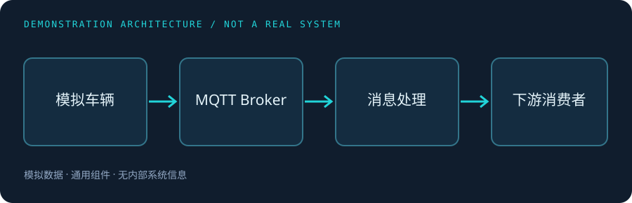

> **演示说明**：本案例使用虚构的车辆事件和通用架构，仅展示内容模板与技术思路。请在发布个人项目之前替换为经过脱敏和审核的真实材料。

## Background · 问题背景

假设一组测试车辆持续上报状态事件。云端服务需要接收消息、进行基本校验，并将处理结果交给后续消费者。这里关注的是连接短暂中断和重复投递时，系统如何保持可观察、可恢复。

## Responsibility · 我的职责

`[在此填写你真实承担的范围、协作对象与交付内容。]`

## Architecture · 系统结构



演示流程分为接入、校验、处理和消费四步。架构图只使用通用组件名称，不包含内部系统、地址或数据。

## Challenges · 关键问题

- **重复投递**：网络抖动可能带来重复事件，消费者需要依据事件标识做幂等处理。
- **短暂断连**：连接恢复后要明确重订阅、重放与消息顺序的边界。
- **处理积压**：下游处理变慢时需要监测队列深度，并定义背压策略。

## Solution · 方案与取舍

演示方案以事件 ID 作为幂等键，使用有过期时间的状态记录避免短时间内重复处理。对需要严格顺序的事件，按车辆标识分区处理；对不要求全局顺序的事件，允许并行消费。设计时应结合实际 QoS、存储能力与业务一致性要求取舍。

```go
// 仅用于说明处理顺序，不包含生产系统实现。
func handle(event Event) error {
    if err := validate(event); err != nil { return err }
    if alreadyHandled(event.ID) { return nil }
    return processAndRecord(event)
}
```

## Results · 结果与边界

`[填写真实测试环境、测试方法、结果与局限；未经验证的数值不要发布。]`

## Lessons · 复盘

可靠性设计应从明确“可丢、可重、可乱序”的业务边界开始。监控和故障演练要覆盖断连、重复消息以及下游不可用的组合场景。
